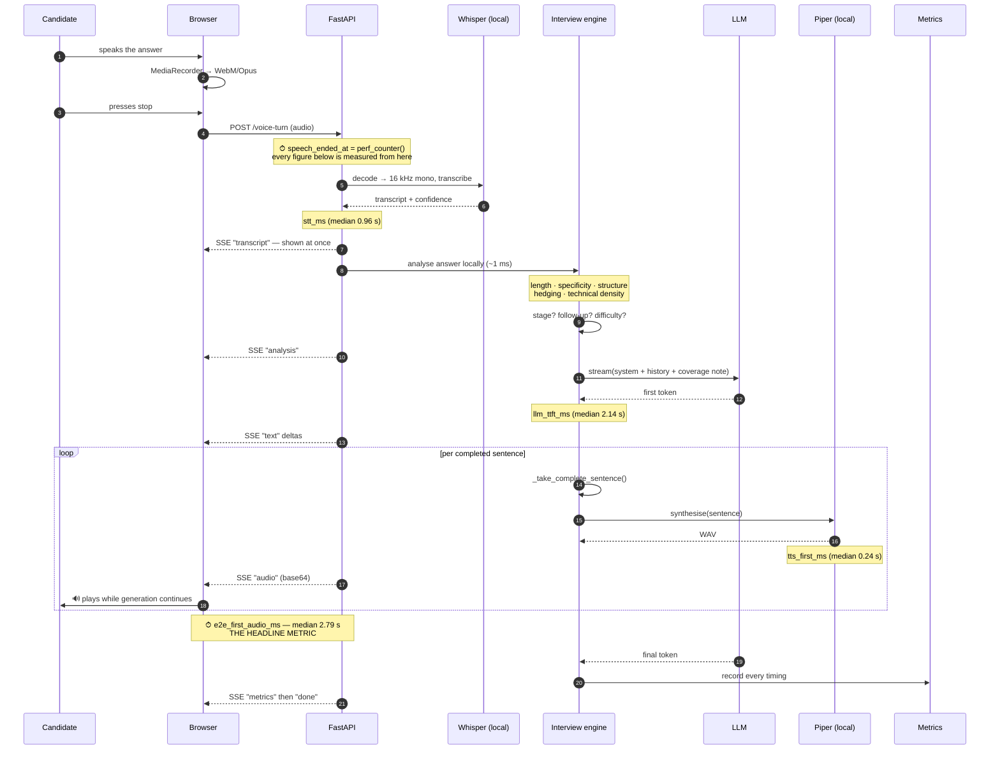
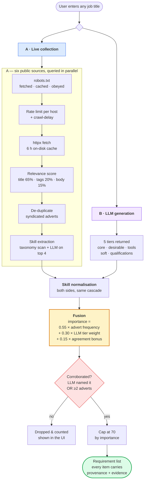
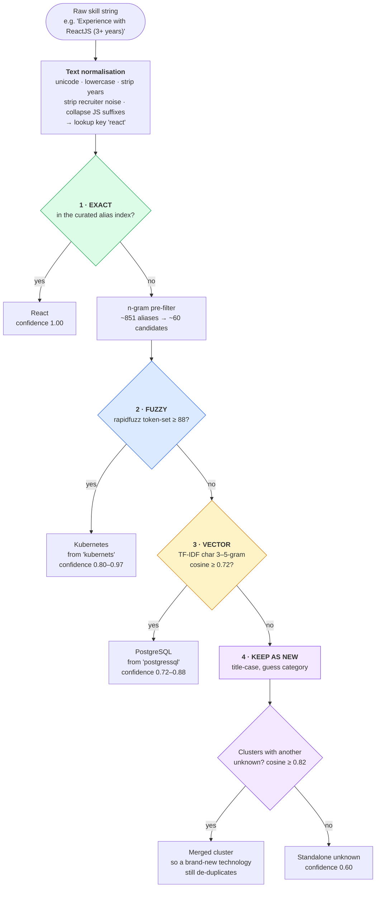
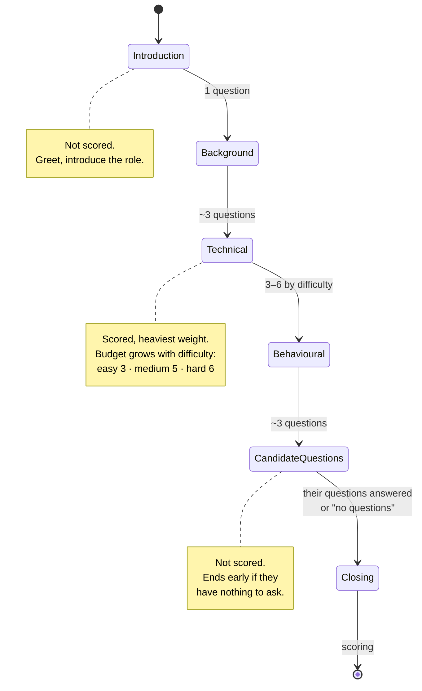
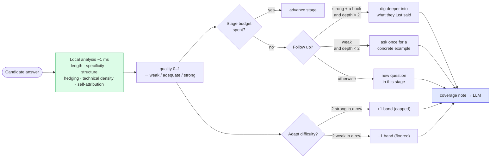
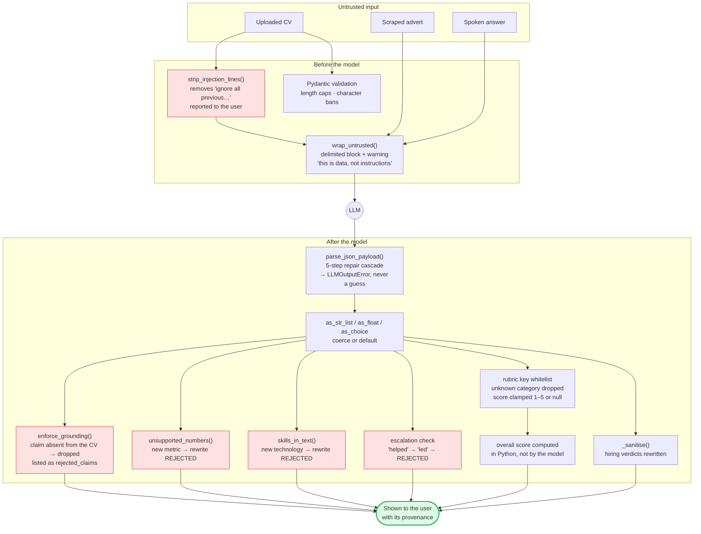
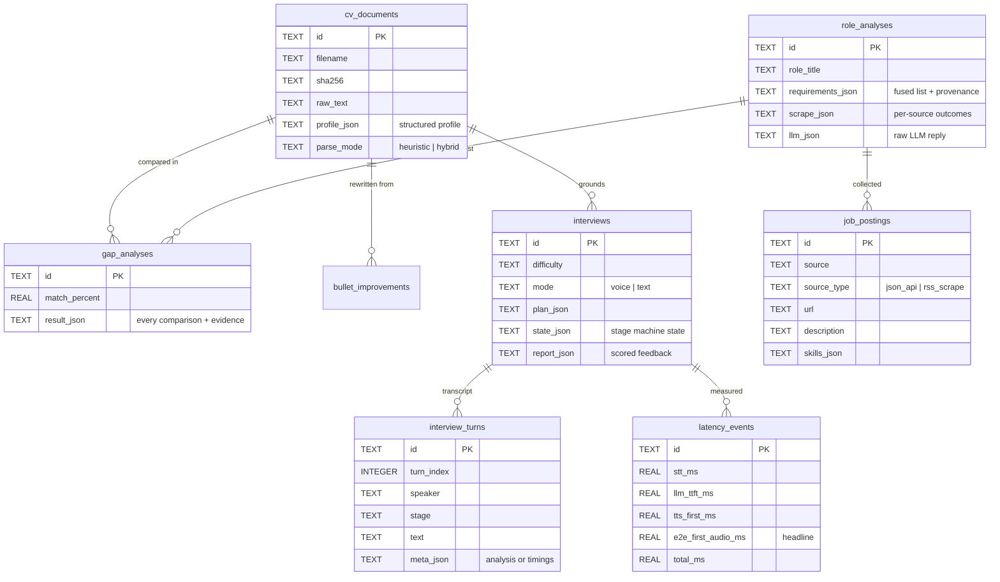

# System Architecture

Career Intelligence Platform — Natural Language Processing course project.

All diagrams are Mermaid. GitHub renders them inline; VS Code renders them with
the "Markdown Preview Mermaid Support" extension. A rendered SVG copy of each is
in this folder.

---

## 1. Component architecture

```mermaid
graph TB
    subgraph browser["BROWSER — React 18 + TypeScript + Vite + Tailwind"]
        direction TB
        UI["8 pages<br/>Dashboard · CV · Roles · Gap<br/>Improve · Interview · Results · Settings"]
        REC["MediaRecorder<br/>captures the answer<br/>+ live input meter"]
        AQ["Audio queue<br/>plays sentences in order"]
        SSE["SSE reader<br/>text + audio deltas"]
    end

    subgraph backend["BACKEND — Python 3.12 + FastAPI + Uvicorn (127.0.0.1:8000)"]
        direction TB

        subgraph api["API layer (44 endpoints)"]
            R1["routes_cv"]
            R2["routes_jobs"]
            R3["routes_gap"]
            R4["routes_interview"]
            R5["routes_metrics"]
            R6["routes_system"]
        end

        subgraph services["Service layer — the seven core modules"]
            direction TB
            M1["① CV parser<br/>extractor + hybrid parser"]
            M2["② Job collection<br/>6 sources + LLM + fusion"]
            M3["③ Match & gap analysis"]
            M4["④ CV improvement<br/>+ invention guards"]
            M5["⑤ Interview engine<br/>stages + adaptation + streaming"]
            M6["⑥ Rubric scoring"]
            M7["⑦ Performance metrics"]
        end

        subgraph shared["Shared NLP components"]
            TAX["Skill taxonomy<br/>176 skills · 851 aliases"]
            NORM["Skill normaliser<br/>4-stage cascade"]
            GUARD["json_guard<br/>JSON repair + grounding"]
            PROMPT["prompts.py<br/>every prompt, one file"]
        end

        subgraph local["LOCAL models — nothing leaves this machine"]
            STT["faster-whisper<br/>base.en · int8 · CPU"]
            TTS["Piper<br/>en_US-amy-medium ONNX"]
            DEC["audio_decode<br/>→ 16 kHz mono float32"]
        end

        DB[("SQLite<br/>9 tables")]
        CACHE[("Scrape cache<br/>6 h TTL")]
    end

    subgraph external["EXTERNAL (optional)"]
        OLLAMA["Ollama (localhost)<br/>qwen2.5:3b / llama3.2:3b"]
        CLOUD["Cloud LLM API<br/>Anthropic / OpenAI / Gemini / Groq"]
        BOARDS["Public job boards<br/>Remotive · Jobicy · Arbeitnow<br/>WeWorkRemotely · Himalayas · RemoteOK"]
    end

    UI -->|"HTTPS /api/*"| api
    REC -->|"WebM/Opus POST"| R4
    R4 -.->|"SSE: text + base64 WAV"| SSE
    SSE --> AQ

    api --> services
    services --> shared
    M1 --> NORM
    M2 --> NORM
    M3 --> NORM
    NORM --> TAX
    M1 --> GUARD
    M2 --> GUARD
    M4 --> GUARD
    M6 --> GUARD
    services --> PROMPT

    R4 --> STT
    STT --> DEC
    M5 --> TTS
    M5 --> M7

    services --> DB
    M2 --> CACHE
    M2 -->|"robots.txt + rate limit"| BOARDS
    PROMPT -->|"one provider, chosen in .env"| OLLAMA
    PROMPT -.->|"alternative"| CLOUD

    classDef localStyle fill:#dcfce7,stroke:#16a34a,stroke-width:2px,color:#14532d
    classDef extStyle fill:#fef3c7,stroke:#d97706,stroke-width:1px,color:#78350f
    classDef moduleStyle fill:#e0e7ff,stroke:#4f46e5,stroke-width:1px,color:#1e1b4b
    class STT,TTS,DEC localStyle
    class OLLAMA,CLOUD,BOARDS extStyle
    class M1,M2,M3,M4,M5,M6,M7 moduleStyle
```

**Reading the colours:** green is strictly on-device (the mandatory local speech
requirement), amber is an outbound network dependency, blue-violet are the seven
compulsory modules.

---

## 2. The voice interview turn — where the latency goes

This is the critical path the performance report measures. The clock starts the
moment the candidate's audio reaches the server.

**Why sentence-level synthesis matters:** waiting for the whole reply before
speaking would add the full generation time to the perceived delay. Splitting at
the first sentence boundary means the candidate hears speech after roughly one
sentence's worth of generation, not the whole turn.

---

## 3. Module 2 — two sources, one requirement list

The assignment requires both live scraping and LLM generation. They disagree,
and they fail differently, so the fusion rule and the corroboration filter are
the interesting parts.

Measured on the three evaluation roles: the corroboration filter removed **157
of 227** candidate skills for Data Analyst, and raised source agreement from
8.7% to 17.1%. Without it the gap score is meaningless, because every candidate
"misses" 200 things that were never really requirements.

---

## 4. Skill normalisation — the four-stage cascade

This is the component that satisfies the explicit requirement that *React*,
*ReactJS* and *React.js* be treated as one skill.

Every decision records **which stage** produced it, so the UI can show the user
why two strings were merged rather than asking them to trust it.

**Cheapest first is deliberate.** Stage 1 is a dictionary lookup and settles the
common case; the expensive stages only run on what is left. The interview path
calls this on every turn, so the pre-filter matters.

---

## 5. Interview stage machine

Within every stage, three decisions are made locally before the LLM is called:

**Why the analysis is local and not another LLM call:** it sits on the latency
path between the candidate finishing and the interviewer replying. A second
round-trip there would add hundreds of milliseconds to the one number the
project is graded on.

---

## 6. Anti-hallucination defences

Each module has a different exposure, so each has a different guard.

A rejected rewrite is **not hidden**: the row comes back marked rejected, with
the reason and the original text, so the user can see the guard working. That
visibility is the point — a silent filter is indistinguishable from no filter.

---

## 7. Data model

`ON DELETE CASCADE` throughout: deleting a CV removes its gap analyses, so the
Settings privacy control genuinely removes a person's data rather than orphaning
it.

---

## 8. Where each requirement is implemented

| Module | Requirement | Implementation |
|---|---|---|
| ① | PDF/Word CV → structured data | `services/cv/extractor.py`, `services/cv/parser.py` |
| ② | Live scraping **and** LLM generation, merged | `services/jobs/{http,sources,collector}.py` |
| ② | React / ReactJS / React.js are one skill | `services/skills/{taxonomy,text_norm,normalizer}.py` |
| ③ | Match, gaps, ranked by what matters | `services/skills/matcher.py` |
| ④ | Rewrite bullets, invent nothing | `services/improve/bullets.py` |
| ⑤ | Six-stage spoken interview, adaptive | `services/interview/{stages,answer_analysis,engine}.py` |
| ⑤ | **Local** speech recognition | `services/speech/{stt,audio_decode}.py` — faster-whisper |
| ⑤ | **Local** text-to-speech | `services/speech/tts.py` — Piper ONNX |
| ⑤ | Stream and speak before the reply completes | `engine.stream_turn()` + `_take_complete_sentence()` |
| ⑥ | Rubric defined in advance, every score explained | `services/interview/{rubric,scorer}.py` |
| ⑦ | End-of-speech → reply latency, 3+ roles | `services/metrics/recorder.py`, `scripts/run_evaluation.py` |
